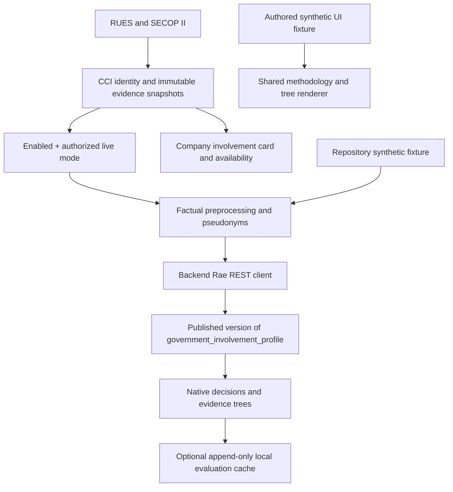

# Rainbird Rae integration manual

Status: experimental RBX adapter, 2026-11-26. A published model connection guide is now available; see [RBX connection setup](rainbird/RBX-connection.md). **No live inference has been validated.**
Company processing is implemented for explicitly authorized live mode, with snapshot-scoped caching,
source-reference resolution, and refresh controls. The model passed a live synthetic test (4.689 seconds,
all four outcomes/sufficiency values and native evidence). The user explicitly approved ongoing minimized company transmission to the configured Rae Enterprise API. Company mode is enabled locally and a real snapshot evaluation passed in 5.918 seconds, with native evidence/source resolution and repeat-request cache reuse.
Demonstrations remain authored synthetic fixtures.

## 1. Executive overview

Government Involvement adds four independent descriptive dimensions to Government Contracts:
direct, historical and recent participation, and execution reported by SECOP II. Each dimension
has its own evidence sufficiency. This is procurement context, never a company risk score.
The feature provides a native card, shared accessible explanation dialog, standalone methodology
page and expandable synthetic/native evidence renderer. Adoption recommendation: **Defer** pending
published-model validation, commercial/data review and a measured live synthetic comparison.

## 2. What is Rainbird Rae?

Rainbird describes Rae as a platform to codify, reason and prove decisions using explicit knowledge.
Knowledge maps contain concepts, instances, relationships, facts and rules; rules infer further facts.
The reasoning engine is distinct from the optional generative authoring and natural-language tools.
CCI uses structured REST queries, never `/nl/interact` or generated `/explain` prose. Facts carry
certainty factors from 1 to 100. These are model certainty semantics, not statistical company-risk
probabilities. CCI's supplied factual assertions use 100; missing facts are omitted or explicitly
represented as missing states, never assigned an invented percentage.
[Overview](https://docs.rainbird.ai/rainbird),
[modeling quickstart](https://docs.rainbird.ai/rainbird/getting-started/quickstart-guide).

## 3. Architecture



CCI owns source retrieval, matching, deduplication, date validation and calendar arithmetic, money,
immutable evidence, and provenance. Rae must derive outcomes and sufficiency from those facts.
`app/integrations/rainbird/mapper.py` emits no terminal classifications. The test-only Python evaluator
is under `backend/tests`, and is never imported by production code. The demo service returns fixed
explicitly labeled examples, with no company/run identity and no external call.

## 4. Rainbird account setup

Create a [Community account](https://app.rainbird.ai/signup) or obtain an Enterprise workspace.
Use only synthetic facts initially. Obtain the user API key from Account or map publishing controls,
and an evidence key from the knowledge map's Publish access controls. Keys stay in backend environment
variables. No account was created or paid plan purchased by CCI. The user supplied a connection guide for a published model; it has not yet been live-tested by CCI.
Community credentials do not authorize commercial production use.

## 5. Knowledge model setup

The version-controlled [declarative specification](rainbird/government_involvement_profile.json)
is a **CCI design specification, not Rainbird RBL or an importable map export**. Do not upload it as
if its syntax were accepted. The user supplied a published-build API guide, but no native model export or live test report has been captured.
Reproduce the model using the documented Studio concepts/relationships workflow:

1. Sign into Studio; create a new map named `government_involvement_profile`.
2. Add each concept and fixed instance in the specification. Add a numeric concept for counts/months,
   date concepts for ISO dates and a string concept for preserved reported status.
3. For each relationship tuple, connect its subject concept to its object concept using the exact
   case-sensitive name. Set `contains_contract` plural; other injected relationships are singular.
4. Add the four terminal relationships from Evaluation Context to Decision Outcome, plus the four
   `<dimension>_sufficiency` relationships to Evidence Sufficiency. Terminal relationships are singular.
5. Add the reusable intermediate relationships described in the specification. In the rule editor,
   create a named rule for each listed positive condition, using a shared contract variable so that
   attribution, signature and execution facts refer to the same contract.
6. Make each outcome's guards disjoint. Negative rules require explicit complete coverage; do not
   interpret failure to find a witness as a complete negative. Missing states must have explicit
   undetermined paths. Historical/recent rules are independent relationships.
7. Implement and validate collection coverage using the Studio-supported collection/expressions
   available in the account. **This step remains unverified**: no exact expression syntax or rule
   priority is assumed by this repository. The specification is not yet an executable model.
8. In Studio, select each terminal relationship and Run Query for `evaluation`. Inject only synthetic
   facts from the mapper. Test every fixture in `backend/tests/fixtures/rainbird/scenarios.json`, including
   all four sufficiency outputs. Reject unexpected questions, conflicting outputs or unsupported negatives.
9. Inspect the result's evidence icon. Confirm actual attribution, temporal, coverage and freshness
   dependencies appear in the native tree; inspect missing/contradictory branches explicitly.
10. Publish a reviewed build, enable secured evidence and record its kmID, any returned `kmVersion.id`, author/reviewer and policy version. Legacy maps additionally pin an integer version. Set backend configuration below.
11. Run the explicitly invoked synthetic smoke command. Capture native outputs, evidence completeness
    and latency before considering any real-company authorization or production activation.

Steps 1–6 describe the verified Studio primitives; steps 7–11 are required deployment/validation work,
not a claim that a map has been created. A validated native export and exact collection expressions
must replace the provisional specification before model portability can be claimed.

## 6. Knowledge model specification

The JSON records all input relationships, terminal names, instances, reusable witnesses and rule guards.
The Evaluation Context instance `evaluation` represents one pinned run. Government Contract instances
are pseudonyms (`contract_1`, …). Company identity is represented by an existing verified-identity fact;
Screening Run, Source Observation and Evidence Record remain in the local provenance envelope rather
than transmitting company or source identifiers. Raw status is preserved. No monetary facts are needed.

Every query returns exactly one supported outcome for the requested dimension. Sufficiency is queried
separately for every dimension. Do not introduce a global sufficiency value that erases a positive
historical witness because some unrelated contract lacks a signature.

## 7. Decision methodology

- Direct: at least one traceable eligible exact-NIT non-group supplier contract establishes documented
  participation. Only a complete scoped query can establish `no_scoped_matches`.
- Historical: a valid signature strictly before the lookback boundary supports `documented`.
- Recent: boundary ≤ signature ≤ evaluation date supports `documented`. Missing/future signatures
  cannot qualify; no start/end/update date substitution is permitted.
- Execution: the latest dated observation reports `En ejecución`, with no relevant unresolved conflict.
  A past scheduled end date generates `execution_past_scheduled_end`; it does not override the status.
  Stale observations cannot establish a current execution conclusion.
- Sufficiency: positive existential findings require a witness; negatives require adequate relevant
  coverage. States are sufficient, limited, missing, stale, contradictory and incomplete.

The default 24 calendar months is configurable (1–120). Subtract calendar months, clamping the day
only when the target month is shorter. Example: 2026-11-26 → 2024-11-26; 2024-02-29 minus 12 months →
2023-02-28. The evaluation day uses America/Bogota. Policy is `government_involvement_v1`.
Execution terminology is corroborated by the official
[SECOP contractual management guide](https://www.colombiacompra.gov.co/wp-content/uploads/2024/10/cce-sec-gi-13eegestioncontractual08-09-2021.pdf).
Unknown mapped statuses cannot support a scoped negative about execution.

**Existing evidence limitation:** SECOP deduplication excludes entire contradictory tied versions,
including value-only differences. The new mapper never reinstates excluded records or changes matching.
The test reference demonstrates desired field-specific behavior, but production cannot claim that
value-only conflict preservation is implemented by the current SECOP snapshot layer. Exclusions make
negative coverage incomplete. Likewise missing observation timestamps cannot enter `ContractView`
without a required retrieval timestamp; future adapters must preserve this distinction explicitly.

## 8. Authentication and configuration

All names below are CCI configuration, not vendor environment conventions:

```dotenv
RAE_ENABLED=false
RAE_EXECUTION_MODE=disabled
RAE_API_BASE_URL=https://enterprise-api.rainbird.ai
RAE_ENGINE=rbx
RAE_MODEL_REFERENCE_MODE=published_build
RAE_API_KEY=
RAE_EVIDENCE_KEY=
RAE_MODEL_ID=
# RAE_MODEL_VERSION=1
RAE_REQUEST_TIMEOUT_SECONDS=30
RAE_CACHE_HOURS=24
GOVERNMENT_INVOLVEMENT_LOOKBACK_MONTHS=24
```

Allowed REST bases are exactly `https://api.rainbird.ai` and `https://enterprise-api.rainbird.ai`.
Redirects are refused. User keys use `X-API-Key`; evidence access uses `x-evidence-key`.
For the supplied wizard model, `RAE_MODEL_ID` pins the build and `RAE_MODEL_VERSION` stays unset.
Use `RAE_MODEL_REFERENCE_MODE=version` with a positive integer only for legacy maps.
For an explicitly authorized synthetic experiment, set `RAE_ENABLED=true`,
`RAE_EXECUTION_MODE=live_experimental`, keys and build ID in a private backend `.env`. The explicit `--live` CLI flag also enables only the synthetic experiment for that process.
Synthetic mode does not enable company transmission. Authorized company mode additionally requires
`RAE_EXECUTION_MODE=live` and `RAE_COMPANY_PROCESSING_AUTHORIZED=true`. Do not add a `VITE_` key or commit secrets.

## 9. API integration

Verified vendor [Decisions API](https://docs.rainbird.ai/rainbird/developer-docs/api-reference/decisions):

```http
GET /start/{kmID}
# For legacy version mode only: append ?version=1
x-rainbird-engine: rbx
X-API-Key: <server key>
```

The documented start response contains `id` (session) and `kmVersion.id`. Inject facts in batches
of at most 250 with `POST /{sessionID}/inject`, JSON array of subject/relationship/object/certainty
triples; require `{"result":"OK"}`. Query using `POST /{sessionID}/query` and
`{"subject":"evaluation","relationship":"recent_participation"}`. A decision response has
`result` entries with subject, relationship/relationshipType, object, certainty and factID, plus `sid`.
CCI rejects questions, missing required results, unexpected outcomes, incompatible supplied session IDs and malformed data. RBX may omit `sid`; the request remains bound to the started session.
No unknown answer is converted to a negative finding. The whole evaluation has one 30-second default
budget; there are no implicit retries (avoids duplicate sessions or inference charges).

[Evidence API](https://docs.rainbird.ai/rainbird/developer-docs/api-reference/evidence):
`GET /analysis/evidence/{factID}/{sessionID}?full=true`. Full responses nest ordinary condition and
expression-contributor evidence. Repeated references terminate cycles; `evidenceError` marks incomplete
branches. The client caps each response at 2 MB and normalized trees at 500 visits/30 levels. A full-tree HTTP 400/413 triggers bounded individual-fact traversal. Missing branch lookups remain unresolved; cycles are deduplicated. Non-inferred root answers do not receive fabricated trees. The smoke test rejects missing/incomplete evidence.
The native decision and sufficiency evidence are retained separately from the normalized display tree.

CCI endpoints:

- `GET /api/v1/companies/{UUID}/screening/secop/involvement?run_id={UUID}`: existing company check and
  company/source/NIT/DV-scoped run validation; returns cached or live decisions for the pinned snapshot.
  Omit run_id to reference the last successful compatible SECOP run. Without successful evidence it
  returns a prerequisite state, never a negative finding.
- `GET /api/v1/government-involvement/demo`: immutable authored example, no real company/run identity.

`POST /api/v1/companies/{UUID}/screening/secop/involvement/refresh?run_id={UUID}` reevaluates the pinned
snapshot. Same-origin enforcement, company refresh rate limits and a database cooldown apply. GET may
perform inference on cache miss, behind authorization/configuration gates, a cross-process company
lock, and a two-call process semaphore. Concurrent requests return running and the UI polls. No public
endpoint accepts arbitrary facts. SECOP retrieval and stored evidence are unaffected by Rae outages.

## 10. MCP integration

Rainbird's overview describes publishing a decision model as an executable MCP tool. The GitBook
[documentation MCP](https://docs.rainbird.ai/rainbird/~gitbook/mcp) serves documentation; it does not
execute `government_involvement_profile`. No executable model MCP URL, authentication, schema or account-specific MCP publication flow was verified. The supplied guide confirms a REST model connection. CCI deliberately uses the documented REST API.
Obtain a published tool's actual definition and permissions before configuring an MCP experiment;
do not infer an executable endpoint from the documentation server URL.

## 11. Evidence-tree interpretation

The shared UI displays conclusion, rule, fact, source and unresolved node kinds with expandable
native disclosures. Synthetic nodes are translation-key-authored examples, explicitly labeled.
Native labels are external evidence and are never translated or rewritten by an LLM.
Native JSON metadata is retained for audit. Missing native branches remain unresolved nodes rather
than being silently pruned. The current UI renders structured native fact data; human-friendly rule
names and a richer native fact layout require real model evidence to validate.

Example synthetic recent chain: conclusion documented → signature 2026-05-14 in interval
2024-11-26…2026-11-26 → verified direct supplier → synthetic observation 2026-11-26.
This is an illustration, **not a captured Rae response**. Source provenance and preprocessing diagnostics
are CCI-owned and remain distinct from the native reasoning tree.

## 12. Execution modes

| Mode | Company evidence | External calls | Display |
| --- | --- | --- | --- |
| Disabled (default) | Never transmitted | None | Availability and methodology |
| Demo | Never transmitted | None | Separate authored synthetic example |
| Live experimental | Blocked | Explicit CLI, fixed synthetic fixture only | Synthetic test results |
| Live + company authorization | Minimized facts only | Cache misses and explicit reasoning refresh | Native decisions, evidence and local source links |

The public demo page remains accessible in disabled mode because it is static explanatory data.
A company page is never substituted with demo findings by the backend. Screenshots simulate the
card using an explicitly labeled synthetic response and synthetic profile.

## 13. Data governance

Never transmit company names, NITs, full descriptions, monetary values, personal identifiers or official
URLs. Mapper facts use local pseudonyms and necessary temporal/status/coverage attributes. Keep their
mapping to evidence IDs and source links locally. Vendor responses are untrusted, bounded and validated;
React text rendering escapes labels. Transport errors expose only machine codes; raw vendor errors,
keys and input payloads are never logged by the integration.
Rainbird documents configurable evidence retention; exact account defaults, deletion obligations,
subprocessors, residency, privacy/DPA terms and Colombian public-data transfer obligations were not
established. Review them before processing real evidence. Do not treat a session ending or expiring
as proof that retained evidence was deleted.

## 14. Caching and versioning

Migration `b6a7203c9101` adds an isolated evaluation table with company/run foreign keys, input fingerprint,
mode, timestamp and complete JSON envelope. Application code only appends; source snapshots are not
modified. Run migrations normally (`make migrate`) before optional persistence.
`rae_smoke.py --live --persist` caches fixed synthetic inputs with a PostgreSQL advisory lock across processes.
Cache identity includes facts/local evidence references, model/build/version, engine, API base, reference mode, policy, evaluation date and mode. `--refresh` appends a fresh result; failures do not replace prior successes. TTL is 24 hours.
Company evaluations and failures append to the same isolated table with company/run IDs. Cache keys
include canonical scope, immutable evidence hashes, facts, date, month configuration, source freshness,
model/reference mode/engine/API base and policy. Database advisory locks prevent duplicate company
inference; success TTL is configured by RAE_CACHE_HOURS and failure cooldown is 60 seconds. Refresh
has an additional database cooldown. A failure can retain a previous successful evaluation only for
the same company/run/configuration, preserving its original native decisions/date with explicit stale
qualification. Source evidence is never modified. Migration c7902ea3b112 indexes company/run history.

## 15. Frontend usage

Open a company → Government Contracts → Government Involvement. Learn more opens a native modal;
Escape closes it and returns focus. Individual dimensions select the corresponding evidence section.
Open in new tab preserves company, run and decision. `/methodology/rae` works independently; use
`/methodology/rae?demo=true&decision=recent_participation` for the isolated synthetic example.
The card remains present when the reasoning endpoint fails, with separate disabled, blocked, failed,
running and stale states. Refresh reasoning updates the cached evaluation. Source references open
allowlisted official links; contract references reuse the shared pinned contract-detail component.
The card and three visualizations form a 2×2 grid above 700px and stack with consistent spacing below.
Text, metadata formatting and controls support English and Spanish.

## 16. Testing and validation

```sh
cd backend
.venv/bin/pytest tests/test_rainbird.py -q
.venv/bin/ruff check .
.venv/bin/mypy app
cd ../frontend
npm test
npm run lint
npm run build
```

The reference evaluator (`backend/tests/rainbird_reference.py`) is test-only. Twenty-four checked-in
reference scenarios state every dimension and sufficiency outcome. They cover the requested business
truth table, duplicates, missing timestamps and mixed complete/incomplete positive evidence. Additional
tests check leap-year/month boundaries, minimization, company scope, fixed hosts, documented REST calls,
malformed/unknown responses, authentication, rate limits and timeouts. These validate the reference
and transport contract; **they do not demonstrate Rae/reference decision agreement**.

Explicit synthetic live smoke (requires configured, reviewed, published model):

```sh
cd backend
.venv/bin/python ../scripts/rae_smoke.py --live
# Optional persistence, only after PostgreSQL and migrations are ready:
.venv/bin/python ../scripts/rae_smoke.py --persist
.venv/bin/python ../scripts/rae_smoke.py --persist --refresh
```

The CLI accepts no company IDs or arbitrary input files. It reports total round-trip time and
outcomes without printing keys, raw payloads or sensitive identifiers. Model-only inference time is
not provided by this implementation. Before adoption, run all synthetic cases against the real model,
compare to the fixture expectations and retain native evidence, not just terminal outcomes.
Visual QA: `backend/.venv/bin/python scripts/rae_visual_review.py` with Vite on 5174.
See [visual evidence](design/assets/rainbird/README.md).

## 17. Troubleshooting

| Code/state | Action |
| --- | --- |
| disabled / blocked | Check live mode, company-processing authorization, API key/model and successful current-policy SECOP snapshot |
| not_configured | Supply a private key and published build ID, then use --live; legacy mode also needs an integer version |
| invalid_credentials / access_denied | Review account/map API permission and keys; never send keys to browser |
| model_not_found | Check environment, map ID and published version |
| rate_limited / timeout / api_unavailable | Retry the explicit experiment later; preserve prior local results |
| invalid_response / unexpected_decision | Check exact relationship names, allowed outcomes and schema drift |
| unresolved_decision / unresolved_sufficiency | Model asked a question or returned ambiguous/incomplete results; fix rules/input coverage |
| invalid_evidence / evidence_limit | Check evidence key, full-response support, missing branches and size; no fabricated tree fallback |
| database unavailable | Start PostgreSQL, configure DATABASE_URL and migrate; static methodology and demo require no DB |

## 18. Costs and licensing

[Hosting options](https://docs.rainbird.ai/rainbird/getting-started/hosting-options) lists Community
as free, subject to fair use, with production queries restricted to non-commercial use. Enterprise
pricing and production limits are custom; obtain a quote. No verified per-query commercial price or
numeric fair-use quota is available. Alternative private-region, self-hosted AWS/GCP and on-premise
options are documented; none was configured. License, retention and hosting review remain blockers.

## 19. Extending the model

Add new inputs to the declarative specification and mapper without introducing final outcomes into
Python. Update Rae rules, terminal validation, response schemas, both language catalogs and fixtures.
Changing month semantics, coverage, status mapping or contradiction behavior requires a policy revision,
new model version and cache invalidation. Obtain a genuine sanitized model export after Studio validation.
Maintain field-specific conflict diagnostics in a separately reviewed evidence change before expanding
beyond the current SECOP exclusion policy.

## 20. Production readiness checklist

Before any real-company call: authorized data transfer; reviewed commercial license/DPA, retention and
residency; validated native model export and immutable version; all synthetic reference comparisons;
actual evidence/source-reference resolution; field-specific contradiction semantics; independently
validated source status mapping; failure/stale lifecycle persistence; database/migration tests;
operational observability and quotas; source-snapshot consistency and company-scoped access tests;
full accessible native-evidence UI review. No current config flag bypasses these boundaries.

## 21. Evaluation results

Observed: local reference and mocked transport/lifecycle tests; bilingual UI tests and responsive
synthetic screenshots; a live synthetic Rae evaluation with matching four decisions, four sufficiency
values and complete native evidence, taking 4.689 seconds end to end. Observed also: one authorized company snapshot evaluated in 5.918 seconds; direct/historical/recent participation documented, reported execution undetermined with stale sufficiency. Unobserved: full live truth-table agreement, model-only inference latency, billable usage, commercial pricing and
rule maintenance effort in Studio.
The Python reference expresses this small policy with much less operational machinery. Rae may add
valuable native evidence and policy ownership, but this value is not demonstrated by mocked tests.
**Defer** adoption until a published synthetic model establishes that value with measured results.

## 22. Official references

- [Rainbird](https://www.rainbird.ai/) and [Rae documentation](https://docs.rainbird.ai/rainbird).
- [Quickstart](https://docs.rainbird.ai/rainbird/getting-started/quickstart-guide).
- [Decisions](https://docs.rainbird.ai/rainbird/developer-docs/api-reference/decisions).
- [Evidence](https://docs.rainbird.ai/rainbird/developer-docs/api-reference/evidence).
- [API flow](https://docs.rainbird.ai/rainbird/developer-docs/api-guide/api-request-flow).
- [Evidence overview](https://docs.rainbird.ai/rainbird/evidence/what-is-evidence).
- [Hosting and editions](https://docs.rainbird.ai/rainbird/getting-started/hosting-options).
- [SECOP II dataset](https://www.datos.gov.co/d/jbjy-vk9h) and [CCI methodology](secop-screening.md).

Official documentation checked 2026-11-26. The main Rainbird website and some documentation URLs did not
load through the research tool; the API, evidence, overview, quickstart and hosting pages did. No vendor sales response, private account terms or executable MCP tool was available for verification. The user-supplied published model guide is retained in docs/rainbird/.


### User-selected lookback

The company card defaults to 24 calendar months. Its slider and integer input allow 1–120 months.
Editing creates a draft and blanks the displayed conclusions; Apply sends `lookback_months` to the
company involvement GET endpoint. The explicit refresh POST accepts the same bounded parameter.
The selected period participates in the evaluation fingerprint/cache and standalone reasoning link;
changing it does not alter the SECOP snapshot or refresh source retrieval. The backend setting remains
the default for API clients that omit the parameter. Boundaries use calendar-month subtraction.

The Government Involvement dialog shows shared conclusion pills and methodology information icons,
a separate sufficiency glossary, and a compact projection of native supporting facts. Identical facts
are deduplicated; different values remain visible. Original native reasoning remains available in a
collapsed disclosure. This projection adds no inference and preserves original source values.
