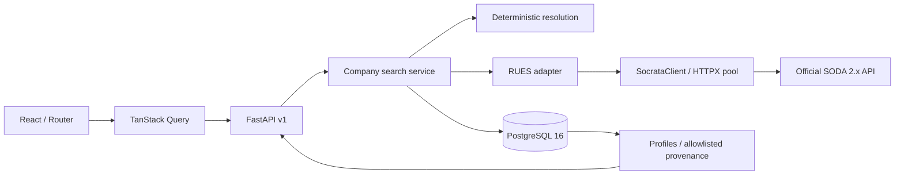

# Architecture and identity decisions

The transport owns fixed-host HTTP, timeouts, pooling, concurrency, bounded retries, size caps,
JSON collection validation, and safe retry logging. The RUES adapter owns verified column names,
controlled SoQL, metadata checks, source dates, and record mapping. Normalization owns deterministic
NIT/name rules. The service owns matching, transactions, caching, and profile assembly. Pydantic
schemas define the public contract. The frontend uses only that contract and never has a source token.

## Registration-scoped companies

NIT is an indexed business identifier, not a primary key or unique constraint. Every company has
a UUID and an internal `rues-c82u-588k:<Socrata :id>` identity key. In this phase the canonical profile
is deliberately scoped to **one registration row**, not an assertion that the registry describes one
uniquely reconciled legal entity. A shared NIT or name never causes an automatic merge. The profile
reports how many other *cached* registrations share the NIT; this is not a complete registry count.

`:id as upstream_id` was verified live. It identifies distinct rows even when a chamber/matrícula/NIT
combination is duplicated or missing. Source system IDs can change during publisher replacement;
future reconciliation must treat them as source identity, not an eternal business identifier. If `:id`
is missing, a hash-based identity is retained and matching is `unresolved`. A changed hash without
a system ID becomes a new unresolved profile. We do not guess a registration key from unrelated fields.

`CompanyAlias` preserves observed legal names (including previous names) with source attribution.
`SourceRecord` preserves complete source payloads in private JSONB. Its unique key is source +
external row ID + SHA-256 hash. Re-fetching identical content updates retrieval time rather than
creating redundant versions. Changed payloads create versions; `source_updated_at` stays separate
from retrieval and official dataset update timestamps. Raw historical data and aliases can contain
personal information: treat the database as restricted data, including backups.

Updates run in one database transaction. PostgreSQL conflict-safe inserts and per-company row locks
prevent concurrent duplicate company creation. Foreign keys preserve source/company relationships.
The application does not create tables on startup: Alembic owns schema lifecycle.

## Search and cache behavior

Each request performs one metadata check and one filtered source query; each has at most two retries
by default. Each page retrieves at most 51 rows (50 results + lookahead), has a bounded offset, and
uses source-side relevance ordering with a final `:id` tie-breaker. A process-wide semaphore caps active upstream operations. No eager downloading,
API fan-out, or background ingestion occurs. User text is a quoted literal, never a SoQL expression.
User `%`/`_` wildcards are removed. Remote matching is a case-insensitive substring query that
removes literal spaces from the source name and whitespace from the query. It does not implement
accent-insensitive full-text search. Shorter distinctive names help.

Live results are ranked **across all matching source records before pagination**, using a controlled
SoQL CASE expression. The API never re-sorts these pages. Tiers prioritize exact legal names,
normalized full names, whole-word phrase prefixes, whole-word phrases elsewhere, word prefixes, and
other substrings. Ranking uses verified `upper`, `unaccent`, `replace`, and `trim` functions; common
punctuation becomes word separators. Ties use normalized words, uppercase legal name, and source
row ID. NIT searches prioritize a supplied verification digit before name/row-ID tie-breakers.
No registration status, renewal date, arbitrary confidence percentage, or entity merge affects rank.
The case/space-insensitive candidate filter is unchanged: sorting does not add typo, accent, or
punctuation variants that the filter excludes. There is no total count. Source updates can shift
offset pages between requests; deterministic ordering is not a snapshot guarantee.
All source candidates remain separate. An explicitly supplied conflicting/missing verification digit
produces `unresolved`, not an exact identifier match. Bare digit strings are never truncated to guess
a verification digit. Format validation does not certify an identifier's DIAN checksum or ownership.

If the source returns no current name matches, exact normalized names/observed aliases and
spacing-insensitive name/alias prefixes in the cache can recover previously consulted variants;
these results carry a cache warning and stale flag. On a source failure, NIT equality or normalized name/alias prefix queries can return cached results,
always explicitly stale. NIT and normalized-name indexes, plus PostgreSQL `text_pattern_ops` prefix
indexes and expression indexes on space-stripped normalized names support those bounded local
queries. Cache fallback does not claim full substring coverage or source-wide ranking. Its response
scope is `current cached page`; live response scope is `all matching source records`.
A failed live request with no cache returns a structured 503, never a false empty result.

## Provenance and states

`FIELD_MAP` is the versioned mapping from API attributes to official column names, exposed alongside
allowlisted source fields. Profile attributes point to source fields and record UUIDs. States include
present, missing from this record, unavailable in this dataset, not checked, and malformed/ambiguous.
Source availability separately reports not-yet-checked, available, or failed-to-retrieve. Multiple
registrations sharing a NIT require manual review; no percentage confidence is invented.

Future financial attributes will need individual evidence versions, units, periods, and transformations.
Keep them in separate bounded-context tables/services rather than adding financial columns to Company.
Future connectors that screen datasets need not implement company search. No plugin framework is needed.

## Deployment boundary

Compose is a local development setup: a PostgreSQL volume, one-shot migration service, API, and Vite
frontend proxy. Ports bind to loopback. It is not a public production deployment. The frontend builds
to static assets; production requires a static host with SPA fallback and an `/api` reverse proxy,
HTTPS, authentication/access policies, request/rate limits, retention controls, and reviewed public-data
usage. Application errors are sanitized and access logs are disabled by the documented launch command.
Never enable query-string logging on a public reverse proxy: searches may contain personal identifiers.

Word-spacing tolerance uses a separate search-only comparison key. The original legal name,
stored normalized name, source records, NIT, and registration-scoped UUID identity are unchanged.
Space-insensitive full-name matches are `normalized_name`; substring matches are `partial_name`,
with explicit evidence. Different entities with colliding compact names remain distinct candidates.
Migration `a4e58b192f70` adds expression indexes for existing company/alias names without a backfill
or data rewrite. The source query remains one bounded request, not a fan-out of guessed word splits.

Advanced source predicates live in `integrations/rues/filtering.py`; validated request schemas are
in `schemas/filters.py`. The source adapter combines predicates before global ordering and pagination.
`services/cached_filters.py` applies equivalent parameterized predicates against the latest JSONB
source record before cached pagination. No migration is required. The privacy-safe versioned
parameter catalog is bundled with the application, exposed through `/api/v1/parameters`, and
refreshed explicitly through bounded aggregation queries. It introduces no normal-search fan-out.
Frontend draft filters are separate from applied URL values; cache keys contain canonical applied
filters, and page/profile navigation preserves them. See `advanced-filters.md` for query semantics.

## Capital-markets evidence layer (Phase 2)

The additive `4e07f6ee2d99` migration introduces `securities_issuers`, `security_instruments`,
`capital_markets_snapshots`, and `issuer_company_matches`. Existing companies, aliases, raw records,
and RUES search contracts remain intact. Issuers can exist before any local company registration.

`integrations/capital_markets` separates safe XLSX/HTML parsing, fixed-host public report transport,
transactional ingestion, conservative matching, local API serialization, and rule-based summaries.
Snapshots retain source/observation/retrieval/publication distinctions and immutable file hashes.
Partial unique indexes prevent multiple verified links for a company or issuer; no NIT primary keys
or parent/subsidiary merges are introduced. Machine links are re-evaluated as cached RUES data grow.

Registration/listing evidence uses snapshots. Capital Markets reads refresh missing or stale RNVE
summaries through isolated Chromium and separate securities reports through a bounded HTTPX client.
Both sources have independent 24-hour success caches and 15-minute failure cooldowns. The administrative CLI imports official
issuer exports and refreshes one selected securities report. BVC findings remain source-dependent; ownership findings remain
unknown. SSRF protection is structural: the transport constructs one allowlisted official report
URL from validated issuer codes and refuses redirects. Capital Markets access can trigger bounded
summary/report ingestion for verified issuers; other profile reads, filters and pagination stay local.
See [data-flow diagram, operations and safeguards](capital-markets.md) and
[verified report schema](capital-markets-sources.md).

## Presentation and public exports

`services/currency.py` provides bounded cached effective SFC TRM observations and Decimal USD
presentation. Browser BigInt formatting retains original COP. `api/exports.py` and `services/exports.py`
project stored public research/filtered snapshot rows into bounded, versioned CSV/JSON. No source
records are rewritten. See [capabilities](capabilities.md), [rates](currency-presentation.md) and
[export contracts](exports.md). References is `/references`; `/advanced` redirects for compatibility.

## RUES lookup deadline and fallback

`SOCRATA_TIMEOUT` defaults to 60 seconds (maximum 60). Company search wraps its complete RUES
network phase in one `asyncio.timeout`: metadata validation, data retrieval, transport retries and
backoff all consume the same budget. Persistence/cache queries and optional RNVE/BVC discovery
remain outside that upstream budget. Request cancellation propagates; only deadline expiration
becomes a source timeout. The shared HTTPX client also uses this setting for transport I/O timeouts;
SECOP retains its independent complete-run deadline.

On expiry, the existing filtered cache fallback is retained. Available cached matches are marked
stale with RUES attribution and an explicit outdated/incomplete warning. No matching cache returns
503, never a fabricated clean empty result. HTTPX timeout exceptions retain `source_timeout`;
other transport failures use `source_unavailable`. Safe retry diagnostics record exception class,
never the search query, NIT, URL, tokens or raw response. Search-specific EN/ES copy identifies RUES,
while other source modules retain their own error wording.
