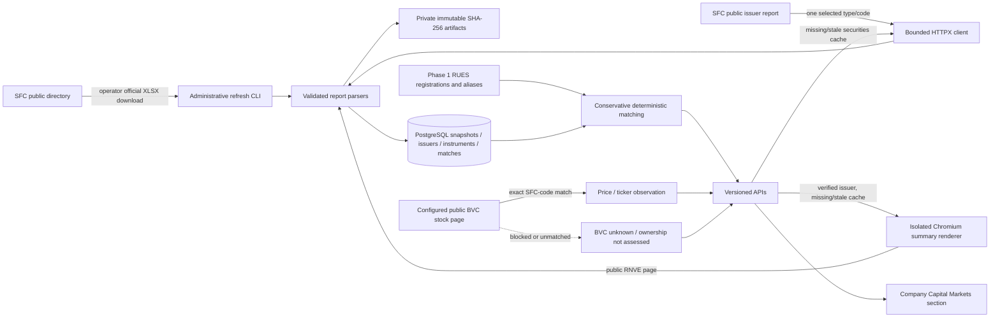

# Capital Markets — operating guide

Phase 2 adds a local evidence layer over Phase 1. Legal form remains sourced from RUES; ownership
is `unknown` / `not_assessed`. RNVE issuer registration, individual securities, and BVC listing
verification are independent. This is not an investment-analysis or ownership-classification module.

## Migrate and import

Apply the additive migration before starting the new backend:

```sh
make migrate
cd backend
# Download DESCARGAR EMISORES > REPORTE EXCEL from the official SFC directory first.
.venv/bin/python -m app.jobs.refresh_capital_markets \
  --issuer-report /absolute/path/Emisores.xlsx \
  --nit-format concatenated-dv
```

Default coverage is incomplete. Only after confirming the current directory is unfiltered and
recording its displayed total, attest completeness (311 is the observed example, not a hardcoded
future total):

```sh
.venv/bin/python -m app.jobs.refresh_capital_markets \
  --issuer-report /absolute/path/Emisores.xlsx \
  --nit-format concatenated-dv --complete-current --expected-count 311
```

The default NIT mode is `preserve`; choose concatenated DV only for the verified report convention.
Missing/invalid/special identifiers stay unverified. Do not use the flag on an unrelated export.
The source defines status through directory context, not a workbook column. Context overrides
`--registration-status registered_cancelled` / `historical` require an independently checked report
context and currently have synthetic-only compatibility testing. Do not use them to relabel a
current-directory file arbitrarily.

Refresh securities for **one imported issuer** at a time, using its source-defined TYPE:CODE key:

```sh
# Example verified issuer, not a parameter shared by other companies:
.venv/bin/python -m app.jobs.refresh_capital_markets --entity 001:001
# Or import a saved copy of that same public issuer-specific HTML report:
.venv/bin/python -m app.jobs.refresh_capital_markets \
  --entity 001:001 --securities-report /absolute/path/banco-report.html
# Reconcile cached companies/aliases against imported issuers without network requests:
.venv/bin/python -m app.jobs.refresh_capital_markets --reconcile
```

The Capital Markets tab automatically retrieves missing or stale summaries and separate securities
reports for verified issuers. Each source has an independent 24-hour success cache and 15-minute
failure cooldown. Directory imports remain administrative; the CLI remains available for explicit
report refreshes. There is no upload endpoint or all-issuer crawl. Match transaction locks are
released before source retrieval. Securities pagination and filter requests read local records only.

Docker import example (from the repository root):

```sh
docker compose run --rm -v /absolute/path/Emisores.xlsx:/imports/Emisores.xlsx:ro backend \
  python -m app.jobs.refresh_capital_markets --issuer-report /imports/Emisores.xlsx \
  --nit-format concatenated-dv
```

The named `capital_markets_data` volume preserves private report artifacts. `docker compose down -v`
removes it along with database volumes. Do not expose its contents through a web server.

## Refresh, failure, and history semantics

Environment variables:

| Variable | Default | Meaning |
|---|---|---|
| `CAPITAL_MARKETS_STORAGE_DIR` | `var/capital-markets` relative to backend working directory | Private content-addressed report files. |
| `CAPITAL_MARKETS_MAX_AGE_HOURS` | `24` | Freshness threshold and operator refresh recommendation, not a claim about source publishing frequency. |
| `CAPITAL_MARKETS_TIMEOUT` | `30` | Total per-source retrieval deadline, including securities retries and connection-pool waits; maximum 60 seconds. |
| `CAPITAL_MARKETS_RETRIES` | `2` | Bounded transient retries, maximum 4. |

Automatic tab access refreshes issuer summaries and securities when their caches expire. You can
also refresh explicitly or schedule the CLI using existing deployment scheduling after deciding an
appropriate source-access policy. The application does not install a scheduler. Directory downloads
remain an operator-mediated step until an authorized documented machine access method is established.
Freshness uses report observation/generation time when present and retrieval time separately; an old
file does not become fresh merely by importing it now. The latest failed refresh also marks retained
evidence stale. No source failure is converted into an absence finding.

Each successful/failed attempt has a snapshot row. Successes track processed/new/changed counts,
source context, observation time, hash, and coverage. Imports validate before applying updates, then
upsert issuers/instruments and source-record versions atomically. Failed transactions roll back all
business changes and commit a separate failure record. Files are immutable and addressed by hash;
repeating identical input does not duplicate issuers/instruments but does record another observation.

Issuer keys use source + regulatory entity type/code, not company UUID or NIT. Instrument keys
retain ANN, issuance, venue and registration date; source name is a fallback only when ANN is missing.
Renaming a security with the same source identifiers preserves its UUID and old source versions.
Ambiguous duplicate identifier tuples are rejected for review. Missing symbols remain missing. Old names/source versions are preserved in private audit
records; SFC never overwrites the company's RUES legal name. Issuers/instruments are not deleted
when omitted from a later file. A prior active issuer omitted from a confirmed complete current
directory becomes historical, without inventing a cancellation date. Older instrument rows are
identified as prior observations if absent from the latest issuer report.

## Matching and negative findings

An eligible exact normalized NIT, compatible DV, and unique local issuer/company registration may
produce a verified link. Database constraints permit only one verified link for each side and one
row per issuer/company pair. Newly cached registrations re-evaluate machine links: shared NITs
become potential, not merged companies. Reviewed/rejected decisions are preserved. Name-only and
alias matches remain potential. No partial NIT, fuzzy brand, parent/subsidiary, or LLM resolution is used.

Potential matches do not attribute a candidate's securities to the company. The capital profile and
securities APIs expose instruments only for verified links. This module does not provide a public
manual-approval endpoint; reviewed decisions require a future authenticated review workflow.

`not_found_in_checked_source` requires all of: an explicitly confirmed complete-current snapshot,
validated ordinary-corporate NIT normalization, freshness, no failed latest issuer refresh, a normal
nine-digit company NIT, no special-structure legal form, and no issuer/candidate link. It means only
no exact-NIT match in that checked current corporate scope. It never means never registered, not
listed, or no historical securities. Incomplete, stale, ambiguous, special, or failed coverage stays
unknown. Check provenance and source limitations before treating a result as a due-diligence finding.

## APIs

All endpoints use local PostgreSQL and Pydantic/OpenAPI schemas:

| Endpoint | Purpose |
|---|---|
| `GET /api/v1/companies/{UUID}/capital-markets` | RNVE finding, potential/verified issuer links, rule-based summary, separate BVC/ownership states, first securities page, source freshness. |
| `GET /api/v1/companies/{UUID}/securities` | Bounded pages (`page`, `page_size` up to 50), optional `security_category`, `exchange`, `listing_status`. |
| `GET /api/v1/capital-markets/issuers` | Bounded local issuer search by `q` NIT or name. Empty q returns a bounded directory page. |
| `GET /api/v1/capital-markets/sources` | Source availability, latest attempt/success, snapshot hashes, retrieval/observation/publication dates. |

```sh
curl 'http://127.0.0.1:8000/api/v1/capital-markets/issuers?q=860002964'
curl 'http://127.0.0.1:8000/api/v1/capital-markets/sources'
curl 'http://127.0.0.1:8000/api/v1/companies/COMPANY_UUID/capital-markets'
curl 'http://127.0.0.1:8000/api/v1/companies/COMPANY_UUID/securities?security_category=corporate_bonds&exchange=BVC&page=1&page_size=10'
```

A source-reported `exchange=BVC` is a registration venue, not the same as
`listing_status=verified_listed`. Currently all SFC-derived listing statuses are unknown and
`equity_listed` is null. Instrument evidence includes original source values and review notes for
present-but-unnormalizable amounts/dates. No arbitrary ANN-to-ISIN/ticker conversion is performed.

## Data flow



## Validation and live smoke

Standard `make test`, `make test-db`, `make lint`, and `make build` remain network-independent for
regulatory tests. New fixtures are generated synthetic XLSX/HTML in memory. Database tests cover
idempotence, failures, source versions, match ambiguity, negative safeguards, pagination, status
history, and upgrading/downgrading the additive migration while retaining Phase 1 data.

Optional source smoke (requires an official export downloaded by the operator):

```sh
backend/.venv/bin/python scripts/capital_markets_smoke.py \
  --issuer-export /absolute/path/Emisores.xlsx --entity 001:001
```

It validates the file and fetches only the named issuer's public securities report, without a
database, app token, raw-record output, or full-directory network crawl.

Known limits: issuer export retrieval is manual; filtered-export semantics, cancelled/historical
report formats, PDF/combined-report parsers, BVC current listings, issuer registration/cancellation
dates, symbols/ISINs, and verified ownership are not live established. See
[the full source assessment](capital-markets-sources.md). New integrations should add their own
schema validation, immutable evidence, source-specific identifiers and matching policy; they must
not reuse the RUES search interface inappropriately or weaken verified-listing semantics.

RNVE profiles include the source entity-type description, business contact details and the requested
administration fields. Workbook contacts are available after reimporting an existing issuer export;
administration is retrieved automatically on Capital Markets access as documented in
[the source guide](capital-markets-sources.md#public-rnve-issuer-summary-details).
Absent source values show red `Missing` pills. Unchecked and failed retrievals have separate states. Sources and verification are collapsed by default.


## Automatic securities report retrieval

`GET /api/v1/companies/{company_id}/capital-markets` now retrieves the separate SFC securities
report for verified issuers alongside summary details. The two sources have independent caches,
snapshots and failures. At most two verified issuer links are processed per request. Per-issuer
worker/PostgreSQL locks suppress duplicate retrieval, and the SFC HTTP connection pool allows two
active connections. SFC uses a dedicated client without Socrata token headers; upstream URLs are
constructed only from verified regulatory type/code and redirects remain disabled.

Valid empty reports are cached as checked observations. Timeout, rate-limit, schema and identity
failures remain failures, never empty findings. Earlier instruments survive failed refreshes and
are marked stale. Retry is suppressed for 15 minutes after failure, then attempted on the next tab
access. Successful reports are cached for `CAPITAL_MARKETS_MAX_AGE_HOURS`, independently of their
official generation timestamps. The frontend waits for profile retrieval before querying the
local securities collection and refreshes that collection after each new profile response.

Live validation on 2026-11-15 retrieved previously unimported reports for Ecopetrol (5 instruments),
Bancolombia (18), and Grupo Aval (8). Grupo Aval was exercised by clicking the Capital Markets tab;
Overview made no capital-markets request. These are dated observations, not hardcoded fixture data.


Manual refresh buttons next to stale/failure alerts invoke the Capital Markets endpoint with
`refresh=true`, bypassing both cache TTLs and failure cooldowns for supported issuer summaries and
securities reports. Locks still coalesce overlapping requests; repeated clicks are disabled while
retrieval is pending. Previous good data remains on screen after failures. Directory and BVC
limitations are unchanged and are explained in the collapsed source-information card. Both this
card and Overview's Data Source Information card share the same disclosure layout.


### Per-source controls and alerts

The source panel is now titled **Data Source Information**. Alert actions reveal this panel and
focus the relevant source; they do not trigger upstream requests. Refresh buttons inside the panel
select `refresh_source=sfc_rnve_issuer_details` or `sfc_rnve_securities` together with `refresh=true`.
Unsupported source IDs and source selection without `refresh=true` return HTTP 422. Legacy
`refresh=true` without selection remains an API option for refreshing both supported sources.
Selected-source refresh skips the other connector, including its automatic stale-cache refresh.

Each stale/failure alert includes the source name, last successful retrieval time, source data date,
last attempt and any recorded sanitized error. Import-directory errors remain global, while summary
and securities records are restricted to the verified issuer(s) linked to the selected company.
An error from another issuer cannot become this company's last error or update timestamp.


The collapsed **Valores registrados (n)** heading shows the unfiltered cached instrument total.
The securities endpoint returns `total` (after category/market/status filters) and `unfiltered_total`
(before those filters). Pages default to 10 records; pagination and counts query local PostgreSQL
and never trigger source retrieval. The table displays ranges such as `1 - 10 de 18`, with an empty
range of `0 - 0` when there are no rows. Issuance values matching valid `YYYYMM` are rendered as
month/year (for example, `198705` → `May, 1987`); other identifiers remain unchanged and the
original source values remain available in each record's provenance details.


## BVC stock-page observations

BVC retrieval uses a separate 15-minute price cache and manual per-source refresh. The current
public-page locator covers Ecopetrol; configure additional known official stock pages with
`BVC_PAGE_URLS` rather than guessing slugs. Only exact Código Superfinanciera/ANN matches on verified
common-equity instruments qualify. The BVC card shows last reported price and ticker with source,
retrieval time and stale status. Live access currently returns HTTP 403; prices are not fabricated.
See [source verification and validation procedure](capital-markets-sources.md#bvc-access-assessment).


La República is a secondary public-browser quote fallback with independent provenance and refresh
via `refresh_source=la_republica_quotes`. Exact matching tries NIT, ANN, then literal legal name
(after Unicode/case/whitespace normalization only). Company-only matches require one eligible
ordinary-equity code. Secondary quotes never upgrade official BVC listing status. Capital Markets
alerts are grouped/collapsed, the summary banner is removed, and no quote match shows a red card
alert. See [access tests and feasibility](quote-source-access.md).


### BVC registration in company search

`GET /api/v1/companies?q=terpel&registered_bvc=true` discovers matching issuers from the
imported official RNVE directory by normalized partial name or exact NIT. It retrieves each
candidate's separate securities report using the existing cache, failure cooldown and locks.
An issuer needs at least one `sfc_rnve_securities` record with category `common_equity` and
trimmed, case-insensitive market `BVC`. Multiple ordinary-share records still establish the
registration indicator; they block only the separate quote lookup.

The service builds a controlled eligible-NIT allowlist and adds it to the **server-side RUES
query before ordering, offset and limit**. The company need not be cached, on the first
unfiltered page, or previously opened in Capital Markets. Each returned registration is
persisted and must acquire a verified issuer link; ambiguous identity yields an explicit
error rather than an incorrect check or silently shortened page. Other search filters combine
with the allowlist, and normal live ranking/page size remain unchanged. No quote is retrieved.
The default (`false` or omitted) leaves RUES unrestricted and annotates returned records using
available RNVE evidence, without fetching a securities report for every RUES result.

Discovery is limited to ten matching RNVE issuers per request and a total configured capital
markets timeout. Broader queries require a more specific name or NIT. The allowlist is bounded
to 500 NITs; it is generated internally and accepts only ASCII digits, never client SoQL.
Source failures, missing directory coverage, timeouts and in-progress report retrieval do not
become false zero-result findings. Successful reports, including empty ones, are cached across
pages. Newly discovered matching issuers extend the registration index automatically.

Coverage still depends on the imported RNVE directory, its names and identifiers, and successfully
retrieved securities reports. This is not a claim of complete live market coverage, current
trading, price or liquidity. Blank check cells mean the positive registration condition has not
been established. In offline deployments without a report retriever, the explicit indexed-search
fallback remains available: it searches cached registrations before pagination and reports
`ranking_scope: "all matching indexed BVC registrations"` with a coverage notice.
