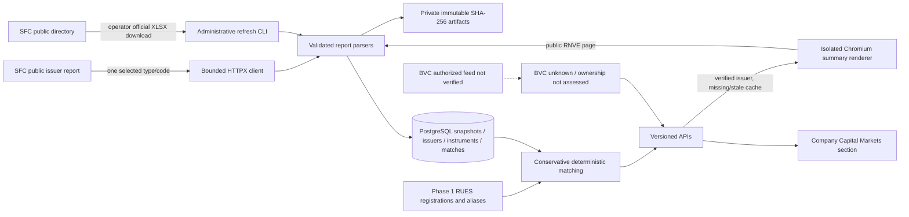

# Capital Markets — operating guide

Phase 2 adds a local evidence layer over Phase 1. Legal form remains sourced from RUES; ownership
is `unknown` / `not_assessed`. RNVE issuer registration, individual securities, and BVC listing
verification are independent. This is not an investment-analysis or ownership-classification module.

## Migrate and import

Apply the additive migration before starting the new backend:

```sh
make migrate
cd backend
# Download DESCARGAR EMISORES > REPORTE EXCEL from the official SFC directory first.
.venv/bin/python -m app.jobs.refresh_capital_markets \
  --issuer-report /absolute/path/Emisores.xlsx \
  --nit-format concatenated-dv
```

Default coverage is incomplete. Only after confirming the current directory is unfiltered and
recording its displayed total, attest completeness (311 is the observed example, not a hardcoded
future total):

```sh
.venv/bin/python -m app.jobs.refresh_capital_markets \
  --issuer-report /absolute/path/Emisores.xlsx \
  --nit-format concatenated-dv --complete-current --expected-count 311
```

The default NIT mode is `preserve`; choose concatenated DV only for the verified report convention.
Missing/invalid/special identifiers stay unverified. Do not use the flag on an unrelated export.
The source defines status through directory context, not a workbook column. Context overrides
`--registration-status registered_cancelled` / `historical` require an independently checked report
context and currently have synthetic-only compatibility testing. Do not use them to relabel a
current-directory file arbitrarily.

Refresh securities for **one imported issuer** at a time, using its source-defined TYPE:CODE key:

```sh
# Example verified issuer, not a parameter shared by other companies:
.venv/bin/python -m app.jobs.refresh_capital_markets --entity 001:001
# Or import a saved copy of that same public issuer-specific HTML report:
.venv/bin/python -m app.jobs.refresh_capital_markets \
  --entity 001:001 --securities-report /absolute/path/banco-report.html
# Reconcile cached companies/aliases against imported issuers without network requests:
.venv/bin/python -m app.jobs.refresh_capital_markets --reconcile
```

The Capital Markets tab automatically renders stale or missing summaries for verified issuers.
Directory and securities refreshes remain explicit administrative operations; there is no public
upload endpoint or all-issuer crawl. Profile reads may reconcile local matches under a transaction
lock, released before summary network retrieval.

Docker import example (from the repository root):

```sh
docker compose run --rm -v /absolute/path/Emisores.xlsx:/imports/Emisores.xlsx:ro backend \
  python -m app.jobs.refresh_capital_markets --issuer-report /imports/Emisores.xlsx \
  --nit-format concatenated-dv
```

The named `capital_markets_data` volume preserves private report artifacts. `docker compose down -v`
removes it along with database volumes. Do not expose its contents through a web server.

## Refresh, failure, and history semantics

Environment variables:

| Variable | Default | Meaning |
|---|---|---|
| `CAPITAL_MARKETS_STORAGE_DIR` | `var/capital-markets` relative to backend working directory | Private content-addressed report files. |
| `CAPITAL_MARKETS_MAX_AGE_HOURS` | `24` | Freshness threshold and operator refresh recommendation, not a claim about source publishing frequency. |
| `CAPITAL_MARKETS_TIMEOUT` | `30` | Public report HTTP timeout, maximum 60 seconds. |
| `CAPITAL_MARKETS_RETRIES` | `2` | Bounded transient retries, maximum 4. |

Run refresh explicitly or schedule the CLI using existing deployment scheduling after deciding an
appropriate source-access policy. The application does not install a scheduler. Directory downloads
remain an operator-mediated step until an authorized documented machine access method is established.
Freshness uses report observation/generation time when present and retrieval time separately; an old
file does not become fresh merely by importing it now. The latest failed refresh also marks retained
evidence stale. No source failure is converted into an absence finding.

Each successful/failed attempt has a snapshot row. Successes track processed/new/changed counts,
source context, observation time, hash, and coverage. Imports validate before applying updates, then
upsert issuers/instruments and source-record versions atomically. Failed transactions roll back all
business changes and commit a separate failure record. Files are immutable and addressed by hash;
repeating identical input does not duplicate issuers/instruments but does record another observation.

Issuer keys use source + regulatory entity type/code, not company UUID or NIT. Instrument keys
retain ANN, issuance, venue and registration date; source name is a fallback only when ANN is missing.
Renaming a security with the same source identifiers preserves its UUID and old source versions.
Ambiguous duplicate identifier tuples are rejected for review. Missing symbols remain missing. Old names/source versions are preserved in private audit
records; SFC never overwrites the company's RUES legal name. Issuers/instruments are not deleted
when omitted from a later file. A prior active issuer omitted from a confirmed complete current
directory becomes historical, without inventing a cancellation date. Older instrument rows are
identified as prior observations if absent from the latest issuer report.

## Matching and negative findings

An eligible exact normalized NIT, compatible DV, and unique local issuer/company registration may
produce a verified link. Database constraints permit only one verified link for each side and one
row per issuer/company pair. Newly cached registrations re-evaluate machine links: shared NITs
become potential, not merged companies. Reviewed/rejected decisions are preserved. Name-only and
alias matches remain potential. No partial NIT, fuzzy brand, parent/subsidiary, or LLM resolution is used.

Potential matches do not attribute a candidate's securities to the company. The capital profile and
securities APIs expose instruments only for verified links. This module does not provide a public
manual-approval endpoint; reviewed decisions require a future authenticated review workflow.

`not_found_in_checked_source` requires all of: an explicitly confirmed complete-current snapshot,
validated ordinary-corporate NIT normalization, freshness, no failed latest issuer refresh, a normal
nine-digit company NIT, no special-structure legal form, and no issuer/candidate link. It means only
no exact-NIT match in that checked current corporate scope. It never means never registered, not
listed, or no historical securities. Incomplete, stale, ambiguous, special, or failed coverage stays
unknown. Check provenance and source limitations before treating a result as a due-diligence finding.

## APIs

All endpoints use local PostgreSQL and Pydantic/OpenAPI schemas:

| Endpoint | Purpose |
|---|---|
| `GET /api/v1/companies/{UUID}/capital-markets` | RNVE finding, potential/verified issuer links, rule-based summary, separate BVC/ownership states, first securities page, source freshness. |
| `GET /api/v1/companies/{UUID}/securities` | Bounded pages (`page`, `page_size` up to 50), optional `security_category`, `exchange`, `listing_status`. |
| `GET /api/v1/capital-markets/issuers` | Bounded local issuer search by `q` NIT or name. Empty q returns a bounded directory page. |
| `GET /api/v1/capital-markets/sources` | Source availability, latest attempt/success, snapshot hashes, retrieval/observation/publication dates. |

```sh
curl 'http://127.0.0.1:8000/api/v1/capital-markets/issuers?q=860002964'
curl 'http://127.0.0.1:8000/api/v1/capital-markets/sources'
curl 'http://127.0.0.1:8000/api/v1/companies/COMPANY_UUID/capital-markets'
curl 'http://127.0.0.1:8000/api/v1/companies/COMPANY_UUID/securities?security_category=corporate_bonds&exchange=BVC&page=1&page_size=20'
```

A source-reported `exchange=BVC` is a registration venue, not the same as
`listing_status=verified_listed`. Currently all SFC-derived listing statuses are unknown and
`equity_listed` is null. Instrument evidence includes original source values and review notes for
present-but-unnormalizable amounts/dates. No arbitrary ANN-to-ISIN/ticker conversion is performed.

## Data flow



## Validation and live smoke

Standard `make test`, `make test-db`, `make lint`, and `make build` remain network-independent for
regulatory tests. New fixtures are generated synthetic XLSX/HTML in memory. Database tests cover
idempotence, failures, source versions, match ambiguity, negative safeguards, pagination, status
history, and upgrading/downgrading the additive migration while retaining Phase 1 data.

Optional source smoke (requires an official export downloaded by the operator):

```sh
backend/.venv/bin/python scripts/capital_markets_smoke.py \
  --issuer-export /absolute/path/Emisores.xlsx --entity 001:001
```

It validates the file and fetches only the named issuer's public securities report, without a
database, app token, raw-record output, or full-directory network crawl.

Known limits: issuer export retrieval is manual; filtered-export semantics, cancelled/historical
report formats, PDF/combined-report parsers, BVC current listings, issuer registration/cancellation
dates, symbols/ISINs, and verified ownership are not live established. See
[the full source assessment](capital-markets-sources.md). New integrations should add their own
schema validation, immutable evidence, source-specific identifiers and matching policy; they must
not reuse the RUES search interface inappropriately or weaken verified-listing semantics.

RNVE profiles include the source entity-type description, business contact details and the requested
administration fields. Workbook contacts are available after reimporting an existing issuer export;
administration is retrieved automatically on Capital Markets access as documented in
[the source guide](capital-markets-sources.md#public-rnve-issuer-summary-details).
Absent source values show red `Missing` pills. Unchecked and failed retrievals have separate states. Sources and verification are collapsed by default.
