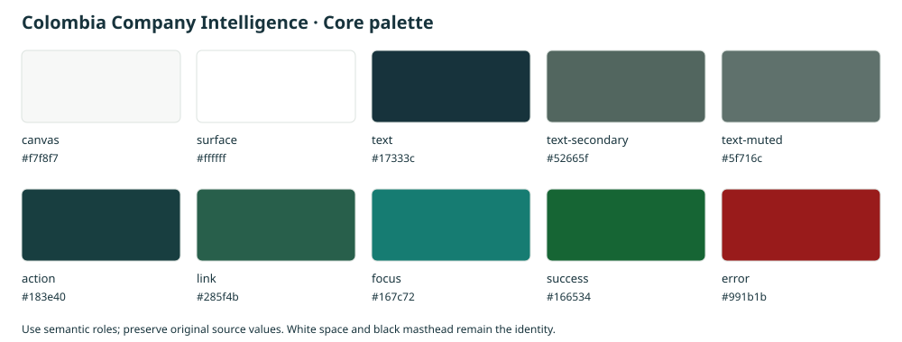

# Colombia Company Intelligence — Brand and UI Guidelines

**Authoritative frontend design reference.** Version 1.1 · 2026-11-19. Read before changing the interface. This manual describes the implemented system, not an aspirational replacement. When a deliberate token/component change is made, update this document and the corresponding visual checks in the same change.

Implementation: [design-tokens.css](../../frontend/src/design-tokens.css), [styles.css](../../frontend/src/styles.css), existing React components in `frontend/src/components`. Decision record: [UI/UX audit](ui-ux-audit.md). Evidence: [visual reference index](assets/README.md).

## A. Brand positioning

**Purpose.** Help researchers find a Colombian company, preserve its registration identity and inspect attributable corporate, capital-market and public-contract evidence.

**Users.** Company and investment researchers, business analysts, procurement researchers and due-diligence teams who need exact identifiers, readable financial amounts and verifiable sources. These are product audiences inferred from the existing workflows; no user interviews were conducted in this pass.

**Value proposition.** A coherent view of otherwise fragmented public records, with explicit provenance, freshness and gaps. The application does not replace the original source or establish an overall regulatory clearance.

**Personality.** Precise, restrained, efficient, transparent and professional. Modern technology should be apparent through reliable interactions and clear evidence rather than decoration or exaggerated intelligence claims.

**Desired perception.** “I can tell which company this is, where a finding came from, when it was checked and what remains unknown.” Never imply regulatory authority, comprehensive background checks, corruption detection, guaranteed completeness or automatic adverse risk conclusions.

## B. Visual identity

### Palette and semantic roles

The existing black masthead, Colombia network logo, dark teal text and restrained green accents remain the identity. Use semantic CSS variables; do not add a new near-identical hex value for each card. Actual core values:

| Role | Token | Value | Use |
| --- | --- | --- | --- |
| Canvas | `--color-canvas` | `#f7f8f7` | Page background. |
| Surface | `--color-surface` | `#ffffff` | Cards, inputs, tables. |
| Subtle surface | `--color-surface-subtle` | `#f3f6f5` | Quiet grouping and row hover. |
| Selected surface | `--color-surface-selected` | `#edf4ef` | Selected tabs and secondary hover. |
| Primary text | `--color-text` | `#17333c` | Facts, headings, values. |
| Secondary text | `--color-text-secondary` | `#52665f` | Explanations, form labels. |
| Muted text | `--color-text-muted` | `#5f716c` | Freshness, captions, metadata. Still readable. |
| Primary action | `--color-action` | `#183e40` | Search; use with white text. |
| Primary hover | `--color-action-hover` | `#245957` | Hover on enabled primary actions. |
| Links | `--color-link` | `#285f4b` | Source and navigation actions. |
| Focus | `--color-focus` | `#167c72` | 3px focus outline with 3px offset. |
| Decorative border | `--color-border` | `#dce3df` | Card/table boundaries; not a control indicator. |
| Control border | `--color-control-border` | `#7b8d85` | Recognizable input/select outlines. |
| Divider | `--color-divider` | `#e3e9e5` | Detail-list rows and group boundaries. |
| Masthead | `--color-header` | `#000000` | Existing black header. |
| Text on dark | `--color-on-dark` | `#ffffff` | Header, primary actions, tooltip text. |
| Secondary on dark | `--color-on-dark-muted` | `#b8b8b8` | Unselected header links. |
| Chart | `--color-chart` | `#2f6b59` | Quiet quantitative accent. No company risk meaning. |

Semantic states use **text + surface + border**, never color alone:

| State | Text | Surface | Border | Meaning |
| --- | --- | --- | --- | --- |
| Success / present | `#166534` | `#f0fdf4` | `#bbf7d0` | A reported state or completed operation, not company quality. |
| Error / missing accent | `#991b1b` | `#fef2f2` | `#fecaca` | Request failure, existing Missing treatment, or raw cancellation label. Read the words. |
| Review | `#9a3412` | `#fff7ed` | `#fed7aa` | Ambiguous/reviewable evidence; not a sanction. |
| Neutral | `#4b5563` | `#f3f4f6` | `#d1d5db` | Unknown or not checked. |
| Stale notice | `#7a4b0d` | `#fff7e4` | `#b98727` | Earlier evidence requiring attention. |
| Information | primary text | `#eaf1ed` | decorative border | Helpful operational guidance. |

Use `--color-success*`, `--color-error*`, `--color-warning*`, `--color-neutral*` and `--color-notice-warning*` tokens. Existing red Missing pills are preserved as an explicit product convention. Do not describe them as negative company findings. Keep errors and missing data textually distinguishable. Disabled controls are inactive, not a statement about a company.



### Typography

Use the existing system stack: `'Avenir Next', 'Segoe UI', sans-serif` via `--font-sans`. No new webfont or remote font dependency. Logos and brand lockups are artwork, not a substitute for readable body copy.

| Purpose | Token | Size at 16px root | Weight / behavior |
| --- | --- | --- | --- |
| Metadata, captions, badges | `--font-size-caption` | 12px | 400–600; never intentionally low-contrast. |
| Table text, compact labels/actions | `--font-size-small` | 13px | 400 or 600. |
| Body text/forms | `--font-size-body` | 14px | 400, line height 1.6. |
| Card title | `--font-size-card` | 16px | 600. |
| Subheading | `--font-size-subheading` | 18px | 600. |
| Section heading | `--font-size-section` | 22px | 600. |
| Metric | `--font-size-metric` | 28px | Tabular numerals; context may require a smaller responsive value. |
| Page title | `--font-size-page` | 32px | 600 or 700. |
| Large profile title cap | `--font-size-display` | 36px | `clamp(26px, 2.5vw, 36px)`; full legal name wraps. |

Weights: `--font-weight-regular: 400`, `--font-weight-medium: 500`, `--font-weight-semibold: 600`, `--font-weight-bold: 700`. Prefer those four weights over ad hoc 550/650 values. Headings use `--line-height-heading: 1.25`. Preserve catalog sentence case; never force every word in Spanish labels to title case.

Numeric metrics and monetary cells use `font-variant-numeric: tabular-nums`. Currency values must **never split over multiple lines**, including at grouping punctuation, spaces, decimals or a currency code. Preserve all digits. Use a wider layout or local horizontal scrolling when needed. The SECOP summary and compact quoted-price display explicitly use `FitMetricValue` to reduce the rendered font size until each exact metric fits one line; this is an approved compact-summary exception to the normal type scale. The full accessible text and native title remain available. Never round, abbreviate or ellipsize an amount just to make it fit.

### Logo and iconography

Keep `frontend/public/colombia-network-logo.png` intact. Do not recolor its Colombia-inspired dots, distort its aspect ratio, regenerate it, add gradients, place it on a busy background, or invent new logo variants. Use `object-fit: contain`. The implemented desktop box is 96×108px; mobile is 64×80px. Maintain at least 16px of clear surrounding space where the existing layout permits. The small brand subline is a lockup exception to the normal text scale; ordinary metadata never inherits that size.

Use the existing simple outline SVG style for info, arrows and navigation. Decorative icons have `aria-hidden="true"`; icon-only actions need localized accessible names. Arrow signs are not a substitute for words or an exact numeric change. Preserve the original source names behind source links.

### Borders, radii and elevation

`--radius-badge: 4px`; `--radius-control: 6px`; `--radius-panel: 8px`; `--radius-dialog: 12px`. Thin 1px borders group content. There is no floating-card elevation stack. Use `--shadow-subtle` only where needed for the search field, `--shadow-popover` for tooltips, and `--shadow-dialog` for the modal. Avoid glass effects and excessive backdrop blur. Static tables and KPI cards do not need shadows.

Light mode is the only implemented theme. Do not add scattered dark-mode overrides or assume this palette is a dark theme.

## C. Layout and spacing

**Content grid.** Main content retains a 1300px maximum (`--layout-max: 81.25rem`) and 5% side gutters (`--layout-gutter`). The masthead spans the viewport. Company profiles retain their existing title/identity, tabs and source-specific content order. Keep the header compact enough to prioritize evidence; desktop minimum is 148px.

**Spacing scale.** `--space-1/2/3/4/5/6/8/10/12/16` = **4/8/12/16/20/24/32/40/48/64px**. Use 8–12px between tightly related labels/controls; 16–24px within a group; 24–32px between groups. General panels use 24px padding and 24px separation; mobile panels use 20px. KPI cards use 12–16px. Do not add empty vertical bands merely to make a dashboard feel spacious.

**Page structure.** One h1 per page; h2 for major sections; h3 for cards/subsections. Use a short eyebrow sparingly. Related facts form a detail list, not a separate card per field. Two-column Overview/Capital Markets cards become one column at 700px. The SECOP summary remains on the right at desktop and retains its 2×2 metrics on mobile. Keep all digits visible on one line. SECOP summary values automatically fit their card width while retaining the 2×2 grid.

**Breakpoints.** CSS media-query values are deliberately literal because CSS custom properties cannot replace query conditions. Canonical thresholds: 480px for compact metrics, 640px for detailed freshness lists, 700px for primary single-column layout/touch actions, and 1100px for longer navigation wrapping. A legacy 380px logo rule remains as a small-lockup accommodation. Test at 320px, 390px, 768px and 1440px; do not silently create another breakpoint for each component.

**Example.** Use `.profile-grid` for two related panels; `.panel` for a section; a `dl` for label/value pairs. Reuse `.market-filters` or `.filter-grid` for existing form patterns. Numeric dense tables retain local horizontal scrolling; page-level horizontal overflow is a defect. Long source names, identifiers and descriptions remain fully accessible.

## D. Core component guidelines

| Existing component/pattern | Purpose / variants | Layout and type | States and behavior | Accessibility and mistakes to avoid |
| --- | --- | --- | --- | --- |
| `SiteHeader`, `LanguageSwitcher` | Main navigation, original brand, EN/ES | Black masthead; small localized links; navigation wraps at 1100px | Active link underline; pressed language button; no route-order changes | Localized nav landmarks, pressed states and visible focus. Do not hide languages on mobile. |
| `SearchForm`, `SearchButton` | Explicit company name/NIT submission | Existing field/button grouping; 14px field, 13px button | Dark primary button, hover, disabled during request; focus-within ring | Label/required/minimum length retained; no search-on-every-keystroke change. Do not remove the focus indicator. |
| `.refresh-button`, `.pagination`, `.copy`, `.filter-clear` | Secondary and operational actions | 40px minimum height, 44px on mobile; 13px text; 6px radius | Quiet border, selected-surface hover, disabled opacity .65, localized busy state | Native buttons, existing disabled rules, focus visible. Do not conflate dismissing a dialog with cancelling a source request. |
| `AdvancedFilters`, `.market-filters` | Source/search restrictions | Labels before controls; coherent 40px field height; control border distinct from card border | Existing applied-vs-draft behavior and query values remain | Associated labels/fieldset/grouping; shared custom Dropdown comboboxes; source option labels follow the explicit display registry; original option values are sent to the API. Never translate option values or reset filters on language switch. |
| `FilterHelp` | Short explanatory tooltip | 32px information button, 12px popover; z-index 20 | Shows on hover/focus; Escape suppresses while interaction remains; leave/reenter restores | `aria-describedby` survives dismissal; pointer can enter tooltip; focus restores predictably. Avoid interactive links inside this short tooltip. |
| `.tabs`, Parameters tablist | Company sections and fixed parameter groups | 40px targets, underlined current tab; native horizontal scrolling | Existing navigation/keyboard arrows and locale state retained | Current state is textual/semantic as well as colored. Do not reorder sources to fit a screen. |
| `.panel`, `.profile-grid` | Group related evidence | White surface, quiet border, 8px radius; 24px padding | Static; no ornamental lift animation | Use headings and detail-list semantics. Do not make every individual fact a KPI. |
| `RegistrationStatus`, `MissingValue`, `ReviewValue` | Reported registration / availability / review labels | 12px badge, explicit words, 4px radius | Existing source tone mapping; Missing/Review visible | Source labels follow only the approved display registry; the original evidence stays untouched. Never turn colors into a risk score or a new finding. |
| Search / securities / SECOP tables | Compare dense source records | 13px cells, 12px headings, local scrolling, sticky headers where a bounded viewport exists | Quiet row hover; exact money right aligned; dates kept together | Named focusable regions, mobile scroll hint, keyboard scrolling. Preserve all columns and exact links. Do not add ellipsis to financial amounts. |
| SECOP query summary | Four verified metrics | 2×2 grid; tabular figures; labels subordinate to values | Actual summary only; unavailable stays unavailable | Exact values stay on one line with `FitMetricValue`; no soft breaks are permitted. No synthetic defaults or revenue claim. Opt-in USD replaces COP in the same metric with an ≈ prefix; source amounts remain unchanged. |
| SECOP `Activity` | Counts/statuses, annual value, buyer ranking | Existing native meters, exact values, approved source label casing | No animation required; all source statuses remain | Values and accessible labels remain available apart from bar length. Do not group arbitrary statuses into Other. |
| `SourceInformationCard`, provenance / methodology / workflow `details` | Progressive disclosure | Native disclosure, clear summary, readable metadata | Existing collapsed defaults and source refresh controls | Keyboard-operable summary, visible focus, original URLs. Do not visually promote source absence into a negative conclusion. |
| `Loading`, `SearchLoadingDialog` | Known in-progress operation | Quiet status notice; existing modal and animation asset | Inline progress remains; Continue browsing or Escape closes only the overlay | Labeled modal, localized exit, polite live status; reduced-motion uses static glyph. No indefinite forced modal. |
| `Failure`, `RefreshAlert`, `.empty` | Error, stale evidence, completed zero result | Separate notice/empty treatments, readable explanation, recovery action | Retain existing retry/refresh and cached results | `role=alert` for failures, status for informational updates. Never replace source errors with zero counts. |
| `PlatformDiagrams` and metric cards | Architecture, technical workflow and diagnostics | Responsive nodes/arrows; full counts; short information definitions | Workflow detail sections start collapsed | Localized captions; decorative arrows hidden from AT. Counts describe local history, not complete source coverage. |

**Interaction dimensions.** `--control-height: 40px`, `--control-height-touch: 44px`, `--control-height-icon: 32px`. WCAG AA’s target-size criterion is a minimum, not a reason to shrink primary actions. Native small checkboxes keep their larger clickable label area. Disabled controls remain legible and retain native disabled behavior.

**Filter refresh stability.** Keep existing table rows while fetching another filter/page within the same verified company and screening run. Mark the table busy and show a reserved-space updating message that identifies previous results. Do not collapse the table and move an open dropdown. Within the same company/run, preserve the table viewport’s measured height when a narrower filter returns fewer rows, bounded by the existing 60vh/480px maximum; keep empty feedback centered horizontally and vertically inside that viewport. The empty message stays within the visible scroll area rather than centering across offscreen columns. Keep pagination ranges tied to the displayed response until its replacement arrives; disable pagination during a placeholder response. Never reuse placeholder records across companies or runs. First load and failures retain their explicit loading/error states.

**Do not duplicate components.** Extend the listed component or existing class family. A visual change does not justify a second search form, a second language switcher or a mobile-specific copy of a source table. React Query, API shapes and page identity are outside the visual system.

## E. Data visualization and evidence conventions

1. **Money:** currency values never wrap or split into several lines. Use `white-space: nowrap`; compact KPI values use the shared `FitMetricValue` component, which measures available space and reduces font size without modifying text. The source record, precision, and accessible value stay unchanged. For tables/charts, preserve a sufficient minimum width and allow local scrolling rather than truncating or splitting the number. Use the shared `i18n/format.ts` helpers with decimal strings. Preserve original scale/precision and currency codes. Never cast a financial amount to Number for display or convert currencies automatically. Optional USD presentation replaces displayed COP with an ≈-prefixed USD amount in the same element and typography; source COP remains unchanged in storage/API/exports. Currency titles and column units follow the displayed currency, and unavailable rates retain COP labels. The header Currency card exposes effective TRM versus manual provenance and information-icon tooltips; see [rate behavior](../currency-presentation.md). Aggregated currencies stay separate. SECOP’s explicit COP convention remains labeled; reported contract value is not revenue or payment.
2. **Alignment:** `.numeric-cell` is right aligned and uses tabular figures. `.date-cell` is a complete date. Short identifiers retain leading zeros. Keep the original order/sort/filter values.
3. **KPIs:** emphasize verified count/value before supporting detail. No zeros for unavailable information. Preserve the SECOP 2×2 summary. Every metric fits one line by reducing its font size when necessary; every digit remains available to reading/copying. Do not use `<wbr>` inside money.
4. **Trends:** keep direction sign, percentage and source date. Green/up does not imply a good company; red/down does not imply a sanction. Do not add a trend arrow when there is no comparison.
5. **Charts:** include units in title/value, exact accessible value text and source status/entity labels following only the explicit display registry. Scale describes the visible verified data. Native meters are deliberately retained; a large chart dependency is not justified for these small summaries. Categorical statuses are not risk categories.
6. **Empty vs missing vs failed:** completed-no-matches describes only the queried dataset; Missing describes absent source fields; Review flags malformed/ambiguous values; unavailable describes inability to retrieve. Preserve these distinctions in words and APIs.
7. **Freshness:** show last success, last attempt and source update separately. Stale evidence remains visible with its warning. A failed refresh never erases prior success in presentation. Do not equate a local retrieval time with the source event date.
8. **Provenance:** preserve exact external URLs, names, statuses, descriptions, source payload field labels and identifiers in evidence and API values. The display-only casing registry below is the sole visual exception. Source references should be easy to find but can sit behind the existing disclosures. Unknown attribution must not be invented.
9. **Promotional material:** use actual app captures; label synthetic data clearly. Do not imply that illustrative contracts, prices, counts or company names are real findings. Use screenshots at native proportions; crop without removing material qualifications.

### Currency context in multi-value sections

If **all monetary values in a summary, table, or card use one verified currency**, state that currency once in the section heading, metric title or table column, in parentheses — e.g. **Valor contractual total (COP)** / **Value (COP)** — and omit its prefix/suffix from individual values. The surrounding unit context must remain unambiguous. Status charts may use a monetary subheading so contract counts are not confused with amounts.

Verify the entire section's currency before omitting codes, including paginated data when applicable. Mixed or unknown currencies must retain explicit per-value codes; never assume COP from the company location, merge currencies, or convert automatically. Individual contract-detail amounts keep their explicit currency. SECOP uses its existing COP policy and a validated common-currency context from the summary; the visible table page is checked for inconsistent currencies too.

### Growing registry: external fields displayed in uppercase

This registry grows only through explicit product decisions. All other external fields remain in their original casing. Casing is a presentation rule, **not a source correction, translation, identity match or data mutation**. It applies in charts, table cells, contract details, filter options and selected filter text. Filters must send the exact original identifier/label expected by the backend. Sort options alphabetically by the displayed source labels using the active locale; preserve date chronology and ranked-by-value chart order. Never merge source records merely because their uppercase labels coincide.

| Source | User-facing field | Frontend field | Verified source field | Display rule |
| --- | --- | --- | --- | --- |
| SECOP II contracts | Estado | `raw_status` | `estado_contrato` | UPPERCASE display; original `raw_status` filter value. |
| SECOP II contracts | Entidad | `buyer` | `nombre_entidad` | UPPERCASE display, including buyer suggestions/input; map known suggestions back to the original `entity` value. |
| SECOP II contracts | Modalidad | `modality` | `modalidad_de_contratacion` | UPPERCASE display; original `modality` filter value. |

Descriptions, company names, original source payloads, supplier NITs and other fields are **not** part of this allowlist. `Screening.tsx` owns this source-specific renderer. A future source must explicitly add its own fields here before applying casing.

### Scrollbar clearance for right-aligned values

Right-aligned numbers must have clear breathing room before a vertical scrollbar. Use a stable scrollbar gutter plus **at least `--space-5` (20px) of content-end padding** in scrolling chart lists; table cells retain their own right padding and scroll containers reserve the gutter. This applies to **Contratos por estado**, **Valor contractual anual (COP)** and **Top cinco entidades por valor contractual (COP)**. Do not let a scrollbar touch, obscure or visually merge with a precise amount. `.secop-bars` uses `scrollbar-gutter: stable` and `padding-inline-end: var(--space-5)`.

## F. UX writing and localization

Use plain, calm language: state what happened, what is known and the next available action. Prefer “Source temporarily unavailable. Try again.” to an internal exception dump. State “No verified contracts in this dataset” rather than “The company has no government contracts.” A check mark means the indicated relationship has supporting evidence, not a seal of regulatory approval.

Labels use sentence case, concise nouns and consistent verbs. Buttons state their action; source links identify the source. Loading copy names the operation; empty copy gives scope and a next step; errors include recovery where available. Avoid “AI-powered” claims, generic risk labels or needless technical prose on the primary research journey. Technical detail belongs in source disclosures and Platform References.

All application-controlled strings belong in `i18n/locales/en.json` and `es.json`. Render translations at component render time using `useTranslation()` or the existing `useLanguage()`/`t` convention. Use plural keys and interpolation for generated counts. Dates/numbers use `Intl` through the shared helpers (`en-US` / `es-CO`), date-only events use UTC and timestamps use Colombia time. Do not concatenate a sentence from unrelated translated fragments in new code.

External source values are rendered directly: **never translate, trim, replace, summarize or pass raw evidence to `t()`** for presentation. Uppercase display is allowed only for the fields listed in the growing registry below; storage, source records, API responses and outgoing filter values retain their originals. Do not translate legal forms, security names, economic activities, buyer names, contract descriptions, raw statuses or source taxonomy options. Apply the approved casing exception only to its named fields. `uiMessage` is only for the explicit allowlist of application-generated API prose, not arbitrary data. EN/ES switching must preserve route, company, filters and cached data.

Retain the established English technical terms **snapshot, cache, fallback, parser and runtime** in Spanish technical prose. See [localization conventions](../localization.md) and [technical glossary](../platform-references.md#spanish-technical-glossary).

## G. Accessibility requirements

Target WCAG 2.2 AA; no conformance claim follows from a screenshot or a passing unit suite. Review:

- [ ] Text contrast at least 4.5:1 for ordinary text and 3:1 for qualifying large text; essential control boundaries and states have 3:1 contrast where required. Decorative dividers may be subtler. Check text on its actual surface, including notices/hover/selected states.
- [ ] Every action reachable by keyboard, with visible, unobscured focus. Skip link targets focusable main content. Named scroll regions support keyboard access.
- [ ] Native labels, landmarks, heading order, table headers and disclosure semantics. Use proper button/link elements.
- [ ] Icon-only actions have localized names. Busy/selected/current/disabled state has semantic exposure. Source status does not rely on color alone.
- [ ] Touch targets follow the dimensions above or a documented spacing/inline exception. Do not rely on a 16px checkbox’s glyph as the entire activation area.
- [ ] Tooltips are hoverable, focusable through their trigger and dismissible with Escape. Modal dialogs have a visible exit and native Escape behavior.
- [ ] Page reflows at 320px and at zoom. Two-dimensional data tables scroll locally, preserving all information. No page-wide overflow.
- [ ] Respect reduced motion; animations convey progress, never factual certainty. Test a slow request and recovery, not just the successful state.
- [ ] Use live regions sparingly. Screen reader testing (VoiceOver/NVDA) is still required before a formal accessibility claim.

The visual browser harness tests representative focus, contrast, target sizing, reflow and reduced-motion behavior. It is not a substitute for manual assistive-technology evaluation.

## H. Motion and interactions

`--motion-fast: 120ms`, `--motion-normal: 180ms`, `--motion-easing: cubic-bezier(0.2, 0, 0, 1)`. Approved: short color/border feedback on enabled controls, existing progress pulse and the existing search retrieval animation. No entrance animations, counter animations, chart rescaling motion, parallax, decorative bouncing, or layout-shifting hover effects.

`prefers-reduced-motion: reduce` removes transitions/animations and uses the search dialog’s existing static icon. Avoid smooth scrolling under reduced motion. Native focus and selection changes remain immediate. Reserve enough room for status feedback to avoid displacing active controls unnecessarily.

## I. Do’s and don’ts

```tsx
// Reuse the existing control and localized state.
<button className="refresh-button" disabled={pending} aria-busy={pending}>
  {t(pending ? 'feedback.refreshing' : 'feedback.refreshData')}
</button>

// Preserve the source value; style its container only.
<td className="numeric-cell">{formatCurrency(contract.value, contract.currency)}</td>
<td>{contract.raw_status /* Apply only the source-specific approved display rule. */}</td>
```

```css
/* Use shared roles; avoid another almost-identical green and an arbitrary size. */
.new-source-card {
  color: var(--color-text);
  background: var(--color-surface);
  padding: var(--space-6);
  border-radius: var(--radius-panel);
}
```

| Do | Don’t |
| --- | --- |
| Apply uppercase display only to registry-listed source fields, retaining original API values. | Blanket `.toUpperCase()` or translation of arbitrary source evidence. |
| Format decimal strings with the shared helper. | `Number(amount).toFixed(2)` or silently convert USD into COP. |
| Label stale results and retain their provenance. | Turn an upstream failure into a reassuring zero. |
| Put technical details in existing native disclosures. | Add an open wall of debug metadata above primary facts. |
| Use a named focusable table scroll region. | Hide mobile columns or truncate precise monetary values. |
| Use existing dark masthead and quiet surfaces. | Add glass panels, rainbow KPI cards or unrelated logo art. |
| Keep long company names fully visible. | Ellipsize or rewrite a verified legal identity. |
| Measure contrast and inspect actual rendered EN/ES pages. | Infer readability from JSX or claim certification from automated tests. |

## J. Future development checklist

Before adding/modifying UI:

- [ ] Read this manual and the relevant existing component.
- [ ] Reuse semantic tokens, spacing, controls, tables and source-state conventions.
- [ ] Preserve logo, navigation order, company identity and data flows.
- [ ] Do not change API/database/matching/financial logic for a visual purpose.
- [ ] Add EN and ES UI keys; preserve external values and locale formatting.
- [ ] Check populated, loading, empty, failed, missing and stale states as relevant.
- [ ] Test keyboard focus, tooltips/dialog exits, contrast and reduced motion.
- [ ] Inspect desktop/mobile (and long Spanish labels); use local table overflow only.
- [ ] Run frontend lint/type/format checks, tests and production build.
- [ ] Update this manual and before/after evidence if the design contract changes.

## Token inventory and source of truth

The appendix below lists the actual values in `design-tokens.css`. Media thresholds and original artwork dimensions remain explicit CSS constants; they are documented above rather than falsely represented as dynamic CSS media variables. Existing complex table column widths remain purpose-specific. Do not replace semantic layout decisions with a token for every individual number.

| Token | Implemented value |
| --- | --- |
| `--color-canvas` | `#f7f8f7` |
| `--color-surface` | `#ffffff` |
| `--color-surface-subtle` | `#f3f6f5` |
| `--color-surface-selected` | `#edf4ef` |
| `--color-text` | `#17333c` |
| `--color-text-secondary` | `#52665f` |
| `--color-text-muted` | `#5f716c` |
| `--color-action` | `#183e40` |
| `--color-action-hover` | `#245957` |
| `--color-link` | `#285f4b` |
| `--color-focus` | `#167c72` |
| `--color-border` | `#dce3df` |
| `--color-control-border` | `#7b8d85` |
| `--color-divider` | `#e3e9e5` |
| `--color-header` | `#000000` |
| `--color-header-hover` | `#242424` |
| `--color-on-dark` | `#ffffff` |
| `--color-on-dark-muted` | `#b8b8b8` |
| `--color-header-border` | `#7f9187` |
| `--color-success` | `#166534` |
| `--color-success-surface` | `#f0fdf4` |
| `--color-success-border` | `#bbf7d0` |
| `--color-error` | `#991b1b` |
| `--color-error-surface` | `#fef2f2` |
| `--color-error-border` | `#fecaca` |
| `--color-warning` | `#9a3412` |
| `--color-warning-surface` | `#fff7ed` |
| `--color-warning-border` | `#fed7aa` |
| `--color-notice-warning` | `#7a4b0d` |
| `--color-notice-warning-surface` | `#fff7e4` |
| `--color-notice-warning-border` | `#b98727` |
| `--color-neutral` | `#4b5563` |
| `--color-neutral-surface` | `#f3f4f6` |
| `--color-neutral-border` | `#d1d5db` |
| `--color-info-surface` | `#eaf1ed` |
| `--color-chart` | `#2f6b59` |
| `--color-backdrop` | `#112c3580` |
| `--font-size-caption` | `0.75rem` |
| `--font-size-small` | `0.8125rem` |
| `--font-size-body` | `0.875rem` |
| `--font-size-card` | `1rem` |
| `--font-size-subheading` | `1.125rem` |
| `--font-size-section` | `1.375rem` |
| `--font-size-metric` | `1.75rem` |
| `--font-size-page` | `2rem` |
| `--font-size-display` | `2.25rem` |
| `--font-size-brand` | `1.25rem` |
| `--font-size-brand-sub` | `0.625rem` |
| `--font-weight-regular` | `400` |
| `--font-weight-medium` | `500` |
| `--font-weight-semibold` | `600` |
| `--font-weight-bold` | `700` |
| `--line-height-body` | `1.6` |
| `--line-height-heading` | `1.25` |
| `--space-1` | `0.25rem` |
| `--space-2` | `0.5rem` |
| `--space-3` | `0.75rem` |
| `--space-4` | `1rem` |
| `--space-5` | `1.25rem` |
| `--space-6` | `1.5rem` |
| `--space-8` | `2rem` |
| `--space-10` | `2.5rem` |
| `--space-12` | `3rem` |
| `--space-16` | `4rem` |
| `--radius-badge` | `0.25rem` |
| `--radius-control` | `0.375rem` |
| `--radius-panel` | `0.5rem` |
| `--radius-dialog` | `0.75rem` |
| `--shadow-subtle` | `0 2px 8px #18342b06` |
| `--shadow-popover` | `0 6px 20px #112c3533` |
| `--shadow-dialog` | `0 24px 80px #112c3533` |
| `--border-width` | `1px` |
| `--control-height` | `2.5rem` |
| `--control-height-touch` | `2.75rem` |
| `--control-height-icon` | `2rem` |
| `--layout-max` | `81.25rem` |
| `--layout-gutter` | `5%` |
| `--motion-fast` | `120ms` |
| `--motion-normal` | `180ms` |
| `--motion-easing` | `cubic-bezier(0.2, 0, 0, 1)` |
| `--z-sticky` | `1` |
| `--z-tooltip` | `20` |
| `--z-skip-link` | `50` |


## Optional presentation and export controls — 2026-11-24

The company header uses a two-column grid with an always-visible Currency card at the top right
(in document flow, not a viewport overlay). At 700px and below it stacks beneath company identity
and aligns right. The card has a labeled custom COP/USD dropdown. USD loads the current effective TRM into
an editable COP-per-USD input; edits are visibly manual, and an accessible refresh-arrow button
restores the reference. No manual date input. Information uses the existing `FilterHelp` component
with focus, Escape dismissal and viewport-contained placement. Rate state remains visible.

USD replaces each COP display in its existing element with an ≈ prefix and the same weight/size,
including summary metrics, chart values, tables, contract details, quoted prices and authorized
amounts. Currency-bearing titles/columns update together. Original source values, filters, chart
ordering and original-currency export fields remain unchanged. Non-COP currencies remain separate.
Invalid/unavailable reference rates retain COP displays/labels and disable USD exports.

One export bar sits above the company title, within the currency provider. It uses the existing
`--color-surface-selected` faded green, a compact custom scope dropdown (company research or the current
filtered contracts), an information tooltip and one Export disclosure button. CSV/JSON choices
appear in an anchored popover using native buttons. Escape restores trigger focus; blur/outside
pointer interaction dismisses it. The bar stays on one line at all supported widths; the short
limit hint is desktop-only, with full limits/warnings retained in the tooltip. Export failures
remain visible below the bar. Contract controls register their active snapshot/filters with the
header bar; no secondary export action remains inside the contracts table panel. References keeps
the existing named table region.
[Visual evidence](assets/currency-exports/README.md) records both languages and responsive widths.


## Shared custom dropdowns — 2026-11-24

Use `components/Dropdown.tsx` for single-value selections: currency, export scope, Government Contracts
filters/sorting, Capital Markets filters and advanced-search modes. The buyer suggestion field uses
its editable combobox variant, preserving arbitrary exact buyer text and original suggestion values.
No HTML select or datalist controls remain. Advanced checkbox multi-selects keep their selection
behavior, styled as the same white, bordered popover with green hover states and a quiet shadow.

Selection triggers and the Export action share `.dropdown-panel` / `.dropdown-option` styles,
existing colors/radii, 40px controls and 44px mobile targets. Options wrap long text, scroll locally
and identify selection with a checkmark plus `aria-selected`. Only the closed trigger may ellipsize
long labels; full option text stays in the accessible description and popup. Source values never change.

Single-select popups are portaled outside clipping panels, positioned relative to the trigger,
flipped above when needed, and bounded to the viewport. Keep `role=combobox`, listbox/options,
accessible labels, expanded/selected/disabled states and active-descendant references. Focus stays
on the trigger; arrows/Home/End/type-ahead navigate, Enter/Space commit, Escape cancels, Tab exits,
and outside pointer interactions dismiss. Editable inputs preserve text-editing keys and free text.
Option buttons retain trigger focus on pointer selection. Advanced multi-select disclosures support
Escape/focus return and blur dismissal. Reduced motion follows existing global behavior.

## Government Involvement — 2026-11-26

The SECOP tab adds a native `.panel` with independent descriptive dimensions. Present findings use
existing success tokens; unavailable/unknown findings use neutral tokens, with explicit text. These
colors describe evidence, never company risk. Reuse the shared Rae methodology content for native
`dialog` and standalone page; Escape returns focus. Evidence uses native details/summary trees with
localized node-kind labels, preserved external fact text and local scrolling. Synthetic evidence is
explicitly labeled. The two-column dimension grid stacks at 700px. No tokens or source-value display
exceptions changed. See [responsive visual evidence](assets/rainbird/README.md).
