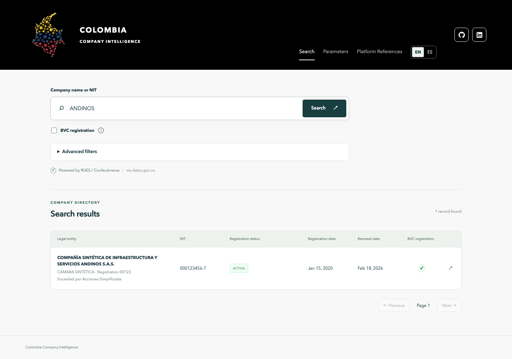
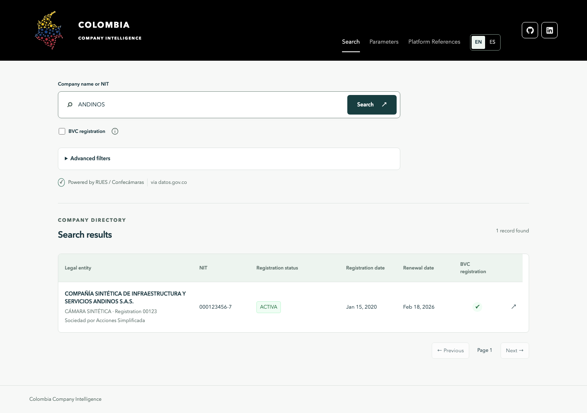
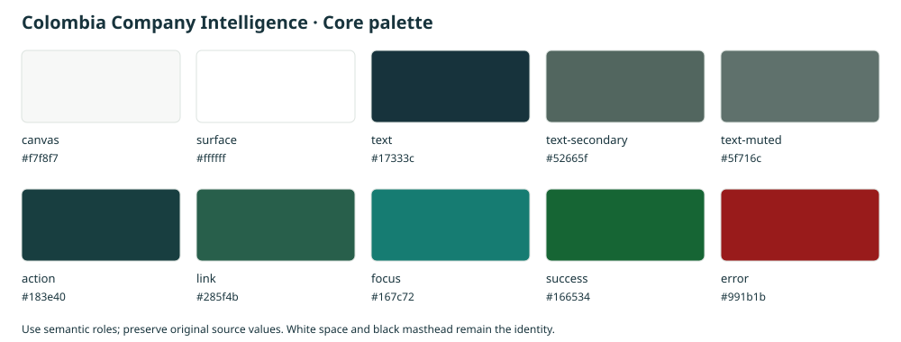

# Actual application visual references

These are real Chromium renders of the existing React application, with deterministic synthetic
API fixtures from [ui-review.json](../fixtures/ui-review.json). The company, contacts, prices,
contracts and metrics are illustrative test responses, **not findings about a real company**.
Network interception is scoped to API responses in an isolated browser context; it does not seed
the application database or call public data publishers. The original logo and application assets
are used unchanged.

Each phase inspects 52 cases: 13 screen/state scenarios × EN/ES × desktop/mobile. To keep the
repository useful, 26 screenshots are retained per phase: EN desktop (1440×1000 viewport) and
ES mobile (390×844), captured full-page. The matching inspection JSON includes the other two
language/viewport combinations and any overflow/browser errors. An additional [narrow-width report](narrow-inspection.json) covers 52 EN/ES cases at 320px and 768px without redundant screenshots. Before captures precede CSS
changes; after captures use the same fixture and viewport settings. These are review artifacts,
not brittle cross-platform pixel snapshots: font rasterization can differ on another OS.

| Scenario | EN desktop before | EN desktop after | ES mobile before | ES mobile after |
| --- | --- | --- | --- | --- |
| home | [before](./before/home-en-desktop.png) | [after](./after/home-en-desktop.png) | [before](./before/home-es-mobile.png) | [after](./after/home-es-mobile.png) |
| results | [before](./before/results-en-desktop.png) | [after](./after/results-en-desktop.png) | [before](./before/results-es-mobile.png) | [after](./after/results-es-mobile.png) |
| overview | [before](./before/overview-en-desktop.png) | [after](./after/overview-en-desktop.png) | [before](./before/overview-es-mobile.png) | [after](./after/overview-es-mobile.png) |
| sources | [before](./before/sources-en-desktop.png) | [after](./after/sources-en-desktop.png) | [before](./before/sources-es-mobile.png) | [after](./after/sources-es-mobile.png) |
| markets | [before](./before/markets-en-desktop.png) | [after](./after/markets-en-desktop.png) | [before](./before/markets-es-mobile.png) | [after](./after/markets-es-mobile.png) |
| secop | [before](./before/secop-en-desktop.png) | [after](./after/secop-en-desktop.png) | [before](./before/secop-es-mobile.png) | [after](./after/secop-es-mobile.png) |
| contract-detail | [before](./before/contract-detail-en-desktop.png) | [after](./after/contract-detail-en-desktop.png) | [before](./before/contract-detail-es-mobile.png) | [after](./after/contract-detail-es-mobile.png) |
| parameters | [before](./before/parameters-en-desktop.png) | [after](./after/parameters-en-desktop.png) | [before](./before/parameters-es-mobile.png) | [after](./after/parameters-es-mobile.png) |
| references | [before](./before/references-en-desktop.png) | [after](./after/references-en-desktop.png) | [before](./before/references-es-mobile.png) | [after](./after/references-es-mobile.png) |
| empty | [before](./before/empty-en-desktop.png) | [after](./after/empty-en-desktop.png) | [before](./before/empty-es-mobile.png) | [after](./after/empty-es-mobile.png) |
| error | [before](./before/error-en-desktop.png) | [after](./after/error-en-desktop.png) | [before](./before/error-es-mobile.png) | [after](./after/error-es-mobile.png) |
| loading | [before](./before/loading-en-desktop.png) | [after](./after/loading-en-desktop.png) | [before](./before/loading-es-mobile.png) | [after](./after/loading-es-mobile.png) |
| stale | [before](./before/stale-en-desktop.png) | [after](./after/stale-en-desktop.png) | [before](./before/stale-es-mobile.png) | [after](./after/stale-es-mobile.png) |

## Before / after examples

### Company search: clearer labels, controls and table hierarchy





### Mobile Overview: preserved structure and original source values

[Before](before/overview-es-mobile.png) · [After](after/overview-es-mobile.png)

### Search progress: a visible exit without cancelling the request

[Before](before/loading-en-desktop.png) · [After](after/loading-en-desktop.png)

## Palette and typography



The palette is generated from the actual token values. Typography examples are visible in the
actual Overview and SECOP captures: profile title, section title, source metadata, status badge,
right-aligned amounts, common-currency headings, and exact single-line KPI values. The latest after captures incorporate the explicit SECOP uppercase display registry; the before captures retain their historical original-case presentation. See the manual for the type scale and weights.

## Reproduce

```sh
# Terminal 1, repository root
make frontend

# Terminal 2, repository root; uses the project's existing backend Playwright install
backend/.venv/bin/python scripts/design_review.py --phase after
```

Optional `--base-url http://127.0.0.1:5173` selects the dev frontend. Screens are regenerated under
`assets/after`; the after phase asserts page reflow, keyboard journey, focus, tooltip dismissal,
modal Escape, precise totals, unchanged descriptions and API values, allowlisted uppercase labels, single-line metrics and contract pagination. It also samples
computed text/background contrast. Reduced-motion is enabled. Keep committed before images as
the historical baseline; running `--phase before` after a UI change does not recreate history.

Manual limitations: no real-user research, screen reader certification, broad publisher access
testing or browser-engine parity claim. The browser matrix isolates UI behavior. Full integration
and arithmetic correctness remain covered by the existing backend tests.
